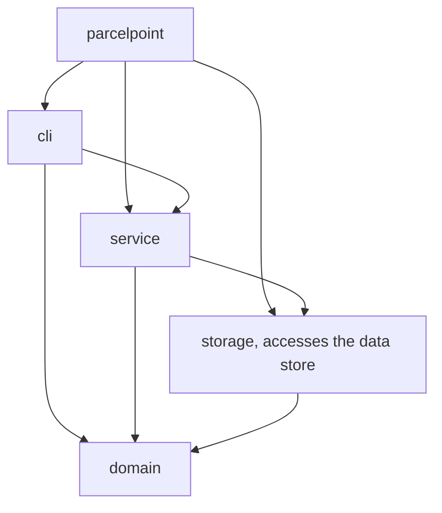
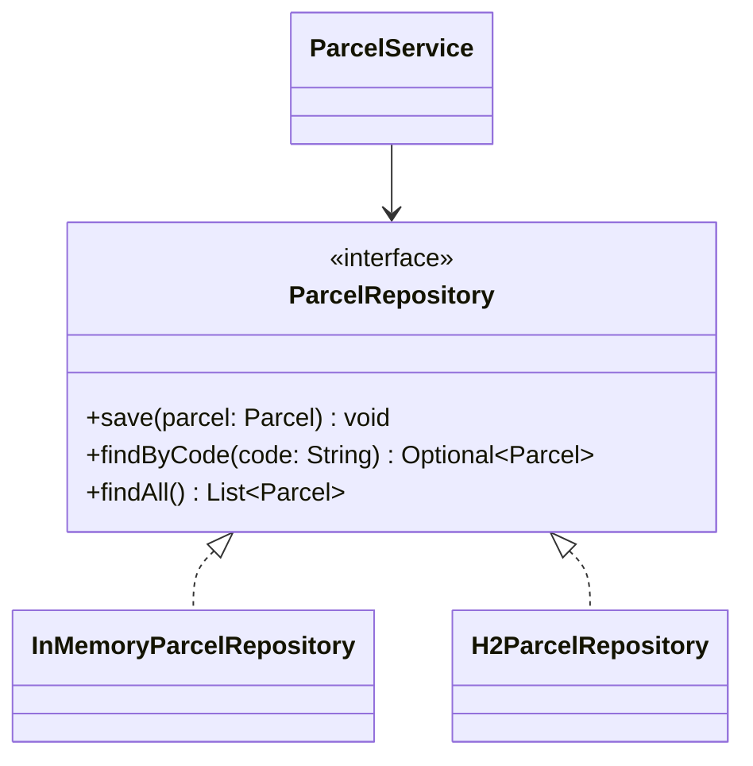
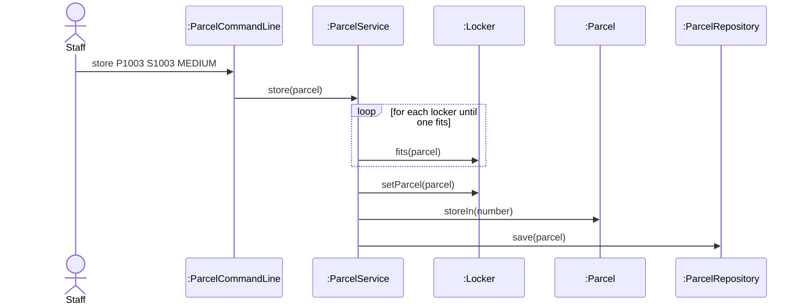

# Lab Report, Designing the Data Management Layer with H2

Repository URL: https://github.com/GoonNapat6788127/itcs382-h2-lab.git

## Tools

| Item | Version or name |
| --- | --- |
| JDK | Oracle JDK 23.0.2 |
| Maven | Apache Maven 3.10.0 |
| IDE | Visual Studio Code 1.145.2 |
| AI tool and exact model, if you used one | ChatGPT GPT-6 |

## Part 0. From a store in memory to H2

Commit of the starter, before any change: e36e9ea

0.3 Your prediction for `staff`, written before the second run:
<br>I predicted that `staff` would list no parcels and would show `Free lockers: 3`, because the program had stopped

Output of the second run, for `staff` and `quit`:

```text
> staff
Free lockers: 3
> quit
```

State in one sentence where you think the parcels of the first run were kept.
<br>The parcels were kept in the memory of the running program.

0.5 The line of Main that you would change to keep the parcels somewhere else:

```java
ParcelRepository repository = new InMemoryParcelRepository();
```

0.6 Commit of the switch to H2: 2e9aac8

0.7 Output of `SELECT * FROM PARCEL;` after you stored two parcels:

```text
sql> SELECT * FROM PARCEL;
CODE  | STUDENT_ID | PARCEL_SIZE | STATUS | LOCKER_NUMBER
P1001 | S1001      | SMALL       | STORED | 1
P1002 | S1002      | LARGE       | STORED | 3
(2 rows, 27 ms)
```

0.8 Explain why ParcelPoint could not start while the H2 Shell was open, and identify the class that wrote the message `Cannot create the PARCEL table`. 
<br>H2 is embedded, so only one program can open the database file at a time, and the Shell held a lock on `parcelpoint.mv.db`. The message was written by `H2ParcelRepository`, which catches H2's `SQLException` and rethrows it as an `IllegalStateException`.

0.9 Explain why `staff` shows no parcel while `find` shows each one, and why all three lockers look free.
<br>`find` calls `findByCode`, which is fully written, so it reads each parcel from H2. `staff` calls `findAll`, which is still a stub that returns an empty list, so no parcel is shown. The `ParcelService` constructor refills the lockers from `findAll()`, so with an empty list no locker gets its parcel back and all three lockers look free.

0.11 Your findAll method:

```java
@Override
    public List<Parcel> findAll() {
        String sql = "SELECT * FROM PARCEL ORDER BY CODE";
        List<Parcel> parcels = new ArrayList<>();
        try (Connection connection = connect();
             PreparedStatement statement = connection.prepareStatement(sql)) {
            try (ResultSet row = statement.executeQuery()) {
                while (row.next()) {
                    parcels.add(toParcel(row));
                }
                return parcels;
            }
        } catch (SQLException e) {
            throw new IllegalStateException("Cannot read the parcels", e);
        }
    }
```

Commit that adds findAll: 8a160a4

0.12 Output of `SELECT * FROM PARCEL;` after the pickup:

```text
sql> SELECT * FROM PARCEL;
CODE  | STUDENT_ID | PARCEL_SIZE | STATUS    | LOCKER_NUMBER
P1001 | S1001      | SMALL       | PICKED_UP | null
P1002 | S1002      | LARGE       | STORED    | 3
(2 rows, 25 ms)
```

0.13 Optional. Describe what `find P9999'OR'1'='1` showed while the SQL was joined from strings, and what it showed after you put the placeholder back.
<br>While the SQL was joined from strings, the input closed the quoted text and added the condition `'1'='1'`, which is true for every row, so the program showed a parcel that does not exist (SQL injection). After I put the placeholder back, H2 compared CODE with the whole typed text as one value, so no row matched and the program showed "No parcel with code P9999'OR'1'='1".
## Part A. Model the design

A1 Complete the flowchart with one node for each package and one arrow for each dependency, from the package that uses to the package that is used. Mark the package that accesses the data store.



State whether cli depends on storage, and explain why.
<br>No, cli does not depend on storage. No file in cli imports a storage class, because cli reaches the data only through ParcelService.

A2 Complete the class diagram of the data management layer with ParcelService, the interface ParcelRepository with its three operations, and the two classes that implement it.



A3 Draw a sequence diagram for the command `store P1003 S1003 MEDIUM`, from the staff member to the repository. Show each message as an operation of the class that receives it.



Explain why the last lifeline is the interface ParcelRepository rather than H2ParcelRepository.
<br>The last lifeline is the interface ParcelRepository because ParcelService knows only the interface, so the diagram stays the same for every data store.

## Part B. Design questions

1. Identify the files that you changed to move from the store in memory to H2, and explain why no other class had to change. Use the terms of this course.
<br>I changed only `Main.java`, the import and the line that creates the repository. No other class changed because `ParcelService` depends on the interface `ParcelRepository`, not a concrete class.

2. The PARCEL table stores the size of a parcel as SMALL, MEDIUM or LARGE rather than as 1, 2 or 3. Identify the type of connascence between ParcelSize and the table in each case, and explain which one is weaker.
<br>Names (SMALL, MEDIUM, LARGE) give connascence of name, and numbers (1, 2, 3) give connascence of convention. Names are weaker because they are readable and stay correct if the enum values are reordered.

3. Project Phase 2 asks for a data store that needs no separate server. Explain why an embedded database such as H2 meets this rule, and describe the limit of an embedded database that Step 0.8 showed.
<br>H2 runs inside the program as a library and creates its own file and tables on the first run, so no server is needed. The limit is that only one program can open the database file at a time.

4. State the data store that you would choose for your Project Phase 2 team, files or an embedded database, the requirement that drives the choice, and the package that will access it.
<br>We chose an embedded database, H2, because the prototype must run from a fresh clone with no separate server. The package `ocs.persistence` accesses it.

## AI usage declaration

| AI tool and exact model | Date | Purpose | Files or answers it produced or changed | How you checked its output |
| --- | --- | --- | --- | --- |
| ChatGPT GPT-6 | 08-11-2026 | Revised grammar and checked spelling | Wording of the written answers in LAB_REPORT.md | I reviewed the suggested changes and checked that the original meaning was preserved |
| ChatGPT GPT-6 | 08-11-2026 | Understanding the assignment instructions| Provided explanations and Java code examples for Steps 0.5 and 0.10 | Compared the explanations with the assignment instructions and reviewed the Java code to understand how it works |
| ChatGPT GPT-6 | 08-11-2026 | Reviewing and check the Mermaid diagrams in sections A2–A3 for consistency | Provided feedback and suggestions for improving | Compared the suggested changes with reviewing to ensure they correctly represented the intended design |
